<p align="center">
  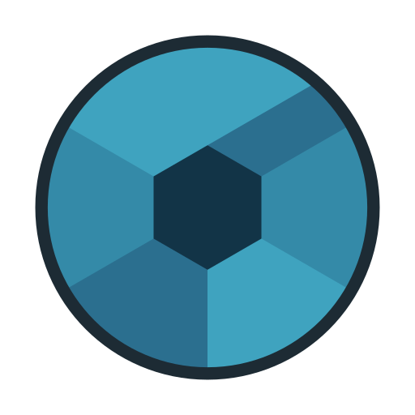
</p>

<h1 align="center">LightCraft Classic</h1>

<h3 align="center">Your photos. Your pixels. Your machine.</h3>

<p align="center">
  <b>A Lightroom Classic-style photo library and raw developer in pure Rust: one catalog, seven modules, Immich built in.</b><br>
  A fork of <a href="https://github.com/storytold/lightcraft">LightCraft</a>. Native on macOS, Windows and Linux. In the browser via WebAssembly. Drivable end to end by AI agents over MCP.
</p>

Pull requests and bug reports are welcome; changes to crates shared with upstream go upstream first (see
[`docs/upstream-merge.md`](docs/upstream-merge.md)).

> [!NOTE]
> The product name, binary names, settings folder and environment-variable prefix are set in one place,
> [`brand.toml`](brand.toml); this README is rendered from `README.md.in` by `cargo xtask docs`. It calls the product "the app"; `<app>`, `<binary>`, `<cli>`, `<mcp_server>`
> and `<settings_dir>` stand for `display_name`, `binary`, `cli_binary`, `mcp_server` and `settings_dir`, and
> `<PREFIX>` for `env_prefix`, from that file.

<p align="center">
  <a href="#two-apps-one-engine">Fork vs upstream</a> ·
  <a href="#seven-modules-one-catalog">Modules</a> ·
  <a href="#edit-like-you-mean-it">Editing</a> ·
  <a href="#color-grading-the-cinematic-way">Color grading</a> ·
  <a href="#before--after">Before &amp; after</a> ·
  <a href="#masking-that-goes-where-you-point">Masking</a> ·
  <a href="#presets-profiles--the-color-mixer">Presets</a> ·
  <a href="#organize-everything">Library</a> ·
  <a href="#built-for-agents">Agents &amp; MCP</a> ·
  <a href="#fast-native-private">Performance</a> ·
  <a href="#feature-status">Status</a> ·
  <a href="#quick-start">Quick start</a> ·
  <a href="ROADMAP.md">Roadmap</a> ·
  <a href="#downloads">Downloads</a>
</p>

<br>

## Two apps, one engine

**LightCraft** ([storytold/lightcraft](https://github.com/storytold/lightcraft)) is the upstream project: an open-source,
clean-room reimplementation of Adobe Lightroom in pure Rust, with its own raw decoders, a scene-referred GPU/CPU
develop pipeline, a command registry that the UI, CLI, control channel and MCP server all share, and a web build. Its
interface follows the modern, cloud-era Lightroom: a single window with All Photos, albums nested in folders, Photo
Grid and Square Grid, a detail view and an Edit panel with a presets column. Its library is a folder holding a JSON
snapshot plus an append-only log of operations.

**LightCraft Classic** is this fork. It keeps upstream's engine (raw decoding, develop pipeline, masking, export, MCP) and
reshapes the app around the Lightroom Classic workflow: one catalog shared by seven modules (Library, Develop, Map,
Book, Slideshow, Print, Web) with the Classic panels (Navigator, Catalog, Folders, Collections, Quick Develop,
Keywording, Metadata), filmstrip and keyboard map. On top it adds what a Classic user expects and upstream does not
have: a redb-backed catalog for large libraries with backups and integrity checks, two-way Immich sync, tethered
capture, publish services, colour-managed printing, WebAssembly plug-ins, Edit In and Actions. Shared crates track upstream and fixes go
back to it as pull requests first.

| | LightCraft (upstream) | LightCraft Classic (this fork) |
|---|---|---|
| **UI shell** | Single-window layout modelled on the cloud-era Lightroom: grid, detail and edit views, side panels, presets column | Lightroom Classic layout: module picker (top right, `Window → Modules`), Navigator / Catalog / Folders / Collections on the left, Quick Develop / Keywording / Metadata on the right, filmstrip, identity plate, secondary window; adjustable mouse-wheel scroll speed |
| **Modules** | Library and editing only | Library, Develop, Map, Book, Slideshow, Print, Web, sharing one catalog |
| **Map** | No map view | Map module: OpenStreetMap tiles, drag-and-drop geotagging, saved locations, tracklogs, reverse geocoding |
| **Book / Slideshow / Web** | Not available | Book (auto layout, templates, text cells with pair kerning and opacity, cover; PDF export), Slideshow (play with music, PDF / JPEG / video export), Web (static HTML galleries, live preview, SFTP upload) |
| **Print** | Contact-sheet PDF (A4/Letter, rows/columns, captions) and soft proofing | Print module: single image / contact sheet, picture and custom packages, rulers, printer ICC profile with rendering intent and black point compensation, Print Adjustment, 16-bit output; print to IPP/CUPS printers (`ipps://` with certificate trust; paper type, tray, quality and two-sided from the driver) or save PDF/JPEG |
| **Catalog format** | Library folder: JSON snapshot + append-only op log, kept in RAM (format v3) | Catalog v4: redb store + op log, several catalogs (New / Open Catalog), scheduled backups, integrity test, optimize; opens and migrates v3 libraries |
| **Immich** | None | Connect one or more Immich (v3+) servers (API key in the system keychain); link existing photos, import from Immich, two-way metadata and album sync, People and smart search, Immich as a publish service, Edit In versions stacked on the original ([docs/immich.md](docs/immich.md)) |
| **Tethering** | None | Studio capture (watched folder) and native PTP tethering over USB or Wi-Fi (PTP/IP) |
| **Plug-ins** | None | WebAssembly plug-ins in a `wasmi` sandbox: menu commands, export post-processing and export destinations, custom metadata fields (edited across the selection, searchable, written to XMP), metadata suggestions, publish services; hooks run off the UI thread (Lightroom Lua plug-ins do not run) |
| **Export & output extras** | Export presets, watermarks, HDR export, contact sheets | Everything upstream has, plus publish services (Hard Drive, Immich, plug-ins), Edit In (copy with adjustments, TIFF / layered PSD) and saved Actions |
| **Lightroom migration** | Reads a Lightroom Classic `.lrcat` | The same importer, landing in a Classic catalog: collections, smart collections (incl. collection and date rules), folder stacks, History and snapshots (as Versions) |
| **Keyboard map** | Its own shortcuts (the commands' declared keys) | Classic keymap by default (E loupe, D Develop, C Compare, N Survey, R crop, Shift+W masking, Tab panels, ⌘⌥1–7 modules, ⌘L Enable Filters, F full-screen preview, F11 full screen); upstream's set is kept as the *Alternative* keymap |
| **Licence** | MIT OR Apache-2.0 (`crates/segment`, `crates/fetch`: Apache-2.0) | MIT (`crates/segment`, `crates/fetch`: Apache-2.0); upstream's copyright notices kept in `LICENSE` and `NOTICE` |
| **Name and identity** | Upstream's own name, icon and app id | Everything from [`brand.toml`](brand.toml): name, binaries, app id, settings folder, env-var prefix, file extensions; reads upstream's settings, env vars and presets on first start |
| **Release channel** | Upstream's GitHub Releases | Built-in auto-updater (checks this fork's release feed, downloads and installs); this repository's own `release` workflow: signed installers and archives for Windows, macOS, Linux and the web, created as draft GitHub Releases of this fork and published after review ([docs/releasing.md](docs/releasing.md)) |
| **Relationship** | The source | Forked at the `fork-base` tag; upstream is merged in regularly with `cargo xtask upstream-merge`; fork-only paths are listed in `upstream-owned.txt`; changes to shared crates go upstream as pull requests first ([docs/upstream-merge.md](docs/upstream-merge.md)) |

## Seven modules, one catalog

The app is laid out like a classic darkroom: one catalog and seven modules, picked from the top-right of the window
(or `Window → Modules`, or ⌘⌥1–7). Library and Develop are where you spend your day; Map, Book, Slideshow, Print and Web
turn the same photos into places, books, shows, prints and websites without leaving the app or exporting first.

<p align="center">
  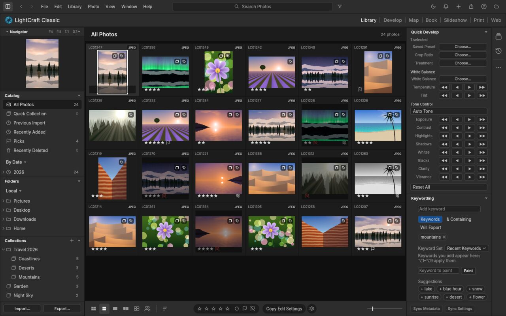
</p>

<table>
<tr>
<td width="50%">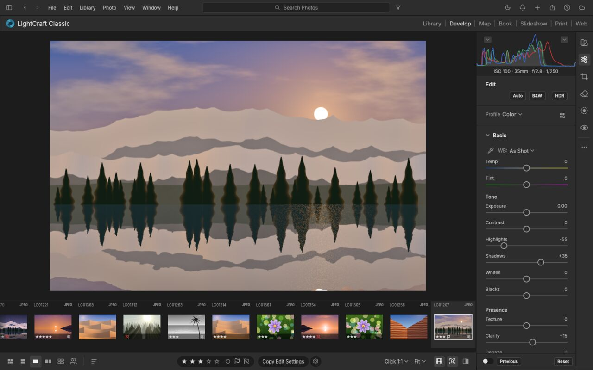<br><sub><b>Develop.</b> Non-destructive raw development, from white balance to masks.</sub></td>
<td width="50%">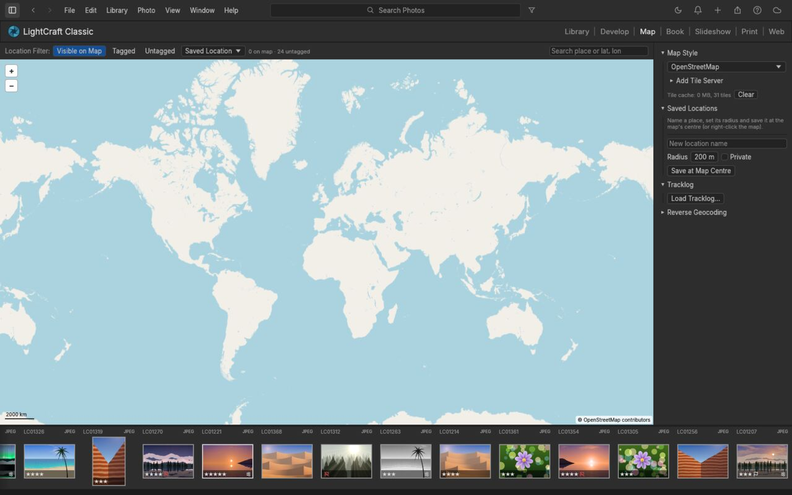<br><sub><b>Map.</b> Geotag by drag and drop, saved locations, GPX tracklogs, reverse geocoding.</sub></td>
</tr>
<tr>
<td width="50%">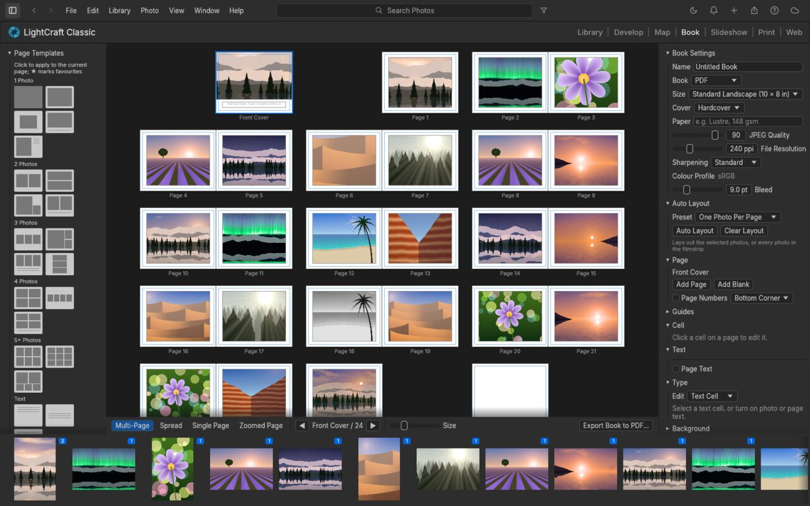<br><sub><b>Book.</b> Auto layout, templates, text cells and cover; exports a print-ready PDF.</sub></td>
<td width="50%">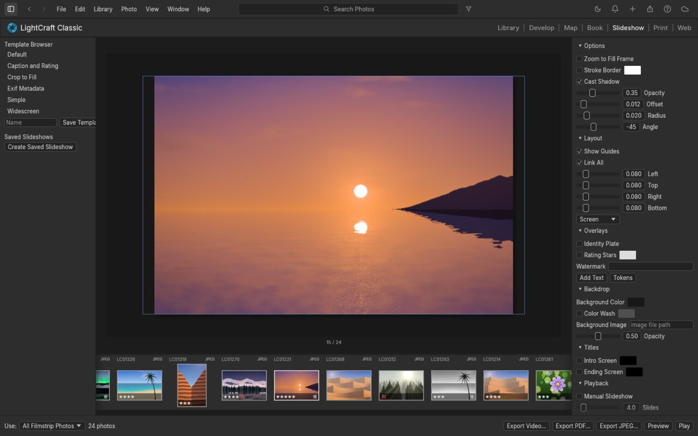<br><sub><b>Slideshow.</b> Play full screen (silently for now), or export the show as PDF or JPEGs.</sub></td>
</tr>
<tr>
<td width="50%">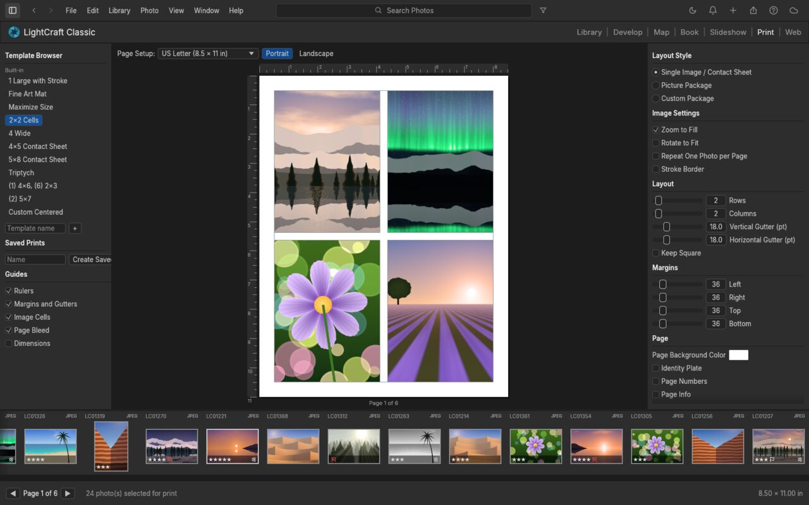<br><sub><b>Print.</b> Single image, contact sheets and picture packages; colour-managed with printer profiles; print or save as PDF/JPEG.</sub></td>
<td width="50%">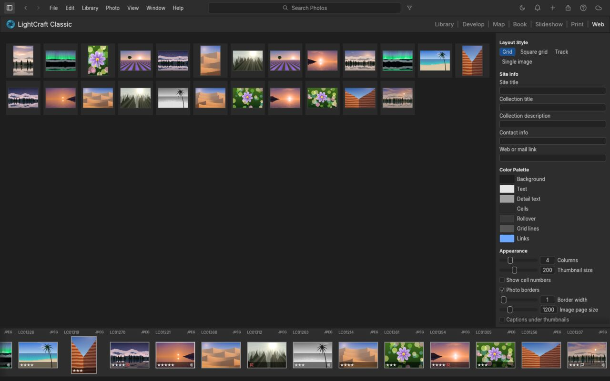<br><sub><b>Web.</b> Static HTML galleries, previewed live and uploaded over SFTP.</sub></td>
</tr>
</table>

## Edit like you mean it

The app is a complete darkroom in a single native app. Every adjustment is **non-destructive**, so your originals
are never touched. Every slider renders through a **scene-referred, wide-gamut, 32-bit float pipeline**: highlights
roll off like film, shadows open up without halos, and colour stays clean from capture to export.

<table>
<tr>
<td width="50%" valign="top">

### ☀️ Light
**Exposure, Contrast, Highlights, Shadows, Whites, Blacks**, with edge-aware local tone mapping (a guided filter on
log-luminance). Pulling −100 Highlights recovers a blown sky without the grey halos you'd get from a naive curve.

### 🎨 Color
**White balance** by temperature and tint (Kelvin for raw, relative for JPEG) with presets, Auto and a
click-to-neutralise **eyedropper**. **Vibrance** that protects skin tones, **Saturation**, an 8-band **Color Mixer**
(hue / saturation / luminance) and 3-way **Color Grading** wheels with blending and balance. All of it is computed in
OkLCh, a modern perceptual colour space.

</td>
<td width="50%" valign="top">

### ✨ Effects
**Texture** for fine detail, **Clarity** for mid-tone punch, **Dehaze** (dark-channel prior with guided refinement;
push it negative to add atmosphere), post-crop **Vignette** with highlight priority, roundness and feather, and
resolution-independent film **Grain** with size and roughness.

### 📈 Tone Curve
Parametric region curve with movable splits **plus** point curves for RGB, Red, Green and Blue. Curves are monotone by
construction, so you never get an accidental tone inversion.

</td>
</tr>
</table>

## Color grading, the cinematic way

Split-tone shadows, midtones and highlights independently with drag-anywhere colour wheels. Below, Dorothea Lange's
*Migrant Mother* gets a warm, print-like tone (highlights at 42°, shadows at 28°) in two drags.

<br>

## Before & after

Hold <kbd>\\</kbd> to peek at the original, press <kbd>Y</kbd> for side by side, or <kbd>Shift</kbd>+<kbd>Y</kbd> for a
split view. Every screenshot in this README is the real app, rendered headless from the procedural demo library by
[`docs/showcase/classic.jsonl`](docs/showcase/classic.jsonl) through the [control channel](#built-for-agents).

<br>

## Masking that goes where you point

Paint with a **Brush** (size, feather, flow, density, erase), drop **Linear** and **Radial Gradients** with draggable
pins, or select by **Luminance Range**, **Color Range**, **Sky**, **Subject** and **Background**. Combine components
with **Add / Subtract / Intersect**, invert any of them, and dial in 15 local adjustments per mask (Temp, Tint,
Exposure, Contrast, Highlights, Shadows, Whites, Blacks, Texture, Clarity, Dehaze, Hue, Saturation, Sharpness, Noise)
plus an overall Amount.

<p align="center">
  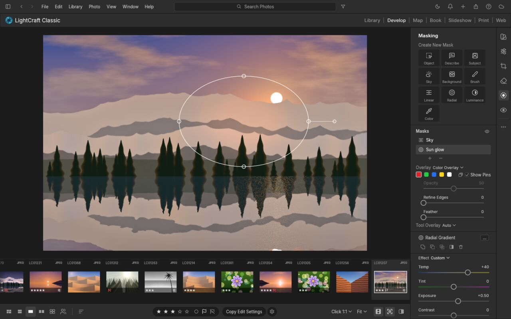
  <br>
  <sub>A radial "Sun glow" mask (Temp +40, Exposure +0.50) layered over a linear "Sky" mask. <i>Photo from the app's procedurally generated demo library.</i></sub>
</p>

<br>

## Presets, profiles & the Color Mixer

Eighteen hand-built presets ship in the box (*Golden Hour, Teal & Orange, Faded Matte, Selenium Tone, Crisp
Landscape* and more), each with an **Amount** slider from 0 to 200 %. Save your own from any group of settings, mark
favourites, and copy, paste or sync edits across a whole selection with exactly the groups you choose.

<table>
<tr>
<td width="50%" valign="top">

### ✂️ Crop, straighten & geometry
Free or locked aspect ratios (1:1, 4:5, 5:7, 2:3, 4:3, 16:9, 16:10, original), drag-to-rotate straightening that always
keeps the largest crop inside the image, thirds / grid / golden-ratio overlays, flips and 90° rotations, plus
manual Vertical, Horizontal, Rotate, Aspect, Scale and Offset transforms.

</td>
<td width="50%" valign="top">

### ⚫️ Black & White
One click (<kbd>V</kbd>) to monochrome, with an 8-band **B&W Mix** that lets you darken skies or make foliage glow.
Then tone it with Color Grading for selenium, sepia or split-tone prints.

</td>
</tr>
</table>

<br>

## Organize everything

A library that stays out of your way: **All Photos**, **Recently Added**, **Picks**, **By Date**, **Albums** nested in
**Folders**, and **Recently Deleted**. Rate with <kbd>0</kbd>–<kbd>5</kbd>, flag with <kbd>P</kbd> / <kbd>X</kbd> /
<kbd>U</kbd>, colour-label with <kbd>6</kbd>–<kbd>9</kbd>. Search understands fields:
`rating:>3 flag:pick iso:>800 camera:x2 date:2026-04 keyword:mountains`. Every view sorts by capture date,
import date, edit date, name, rating, size or at random (a stable shuffle; View → Sort → Reshuffle for a new one). Albums also have a **Custom Order**: drag photos in the grid or filmstrip to set the sequence of a story, and slideshows, books, prints, exports and Rename `{seq}` follow it. The justified **Photo Grid** and **Square Grid** views are virtualized,
so they stay smooth whether you have forty photos or forty thousand.

<table>
<tr>
<td width="50%">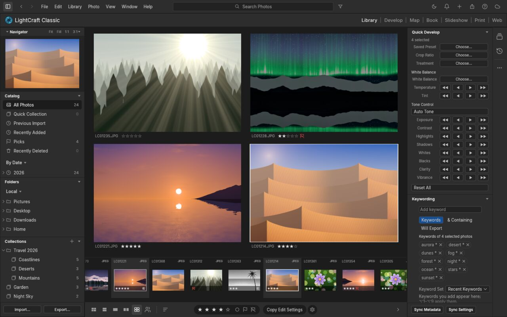<br><sub><b>Survey</b> (<kbd>N</kbd>): narrow a selection down side by side. <i>Demo library.</i></sub></td>
<td width="50%">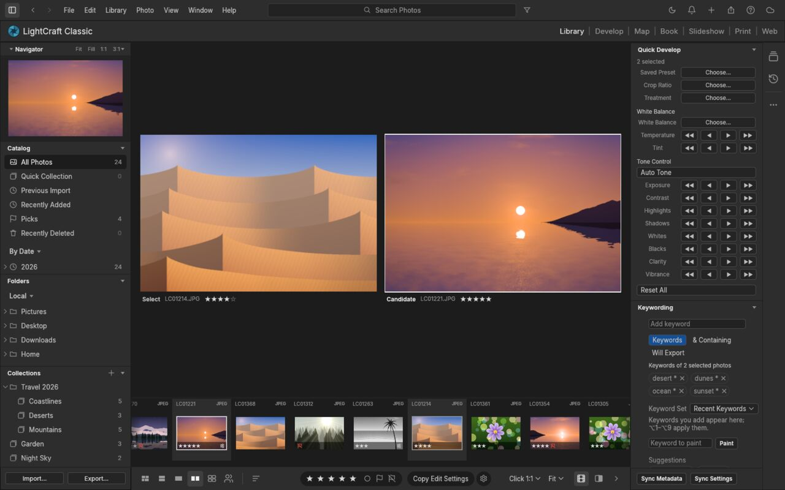<br><sub><b>Compare</b> (<kbd>C</kbd>): Select against Candidate, with synced zoom. <i>Demo library.</i></sub></td>
</tr>
</table>

<br>

## Video, too

Clips live in the same library as your photos. MP4, MOV, MKV, WebM, MPEG-TS and MXF with H.264, HEVC, VP9, AV1,
ProRes, DNxHR, APV or MPEG-2 decode in pure Rust. Play a clip in the loupe (<kbd>Space</kbd>, <kbd>←</kbd> /
<kbd>→</kbd> for single frames), drag the trim handles, pick the poster frame the grid shows, and capture any frame as
a photo. The Light and Color controls (and presets that use only them) grade every frame. Export writes H.264 MP4 or
ProRes MOV with the trim, the grade and the sound (graded on the GPU for H.264); `<cli> render clip.mov -o out.mp4 --trim 2,8` does the same from
the command line. Playback is silent for now, and masks, spot removal, lens corrections and crop don't apply to video.
See [docs/video.md](docs/video.md).

<br>

## Built for agents

Every menu item, slider, brush stroke, crop handle and keystroke in the app is a **command** with a stable id and
JSON parameters. The UI, the keyboard, the CLI, a JSON-lines control channel and an **MCP server** all dispatch
through the same entry point. An agent can cull a shoot, develop it, mask a sky and export it, and *see* the result.

```sh
<binary> --control 7980 ~/Pictures/trip
```
```jsonc
{"method": "engine.execute", "params": {"command": "photo.flag",  "params": {"flag": "pick"}}}
{"method": "engine.execute", "params": {"command": "develop.set", "params": {"values": {"light.highlights": -45, "light.shadows": 38}}}}
{"method": "engine.execute", "params": {"command": "mask.add",    "params": {"kind": "radial", "center": [0.62, 0.4], "rx": 0.2, "ry": 0.14}}}
{"method": "ui.clickWidget",   "params": {"id": "slider:effects.clarity"}}       // drive any widget by name
{"method": "ui.pointer",       "params": {"events": [{"kind":"down","x":0.2,"y":0.3}, {"kind":"up","x":0.4,"y":0.3}]}}
{"method": "ui.screenshot",    "params": {"path": "after.png"}}
```

- **Command registry.** `engine.commands` lists the available commands; `develop.controls` lists every slider's
  range, default and current value.
- **MCP server.** `<cli> mcp` exposes the command registry to Claude (or any MCP client), alongside
  helpers for import, query, develop, mask, render (returned as an image) and export. It runs headless, or attached
  to the running app with screenshots, clicks and gestures. See [docs/mcp.md](docs/mcp.md).

  ```sh
  cargo build --release -p lcc-cli
  claude mcp add <mcp_server> -- "$PWD/target/release/app-cli" mcp ~/Pictures/shoot          # headless
  claude mcp add <mcp_server>-app -- "$PWD/target/release/app-cli" mcp --connect 127.0.0.1:7980  # live app
  ```
- **Scriptable CLI:** `<cli> run --import in.dng develop.set control=light.exposure value=0.7 app.export
  path=out.jpg longEdge=2048` runs any chain of commands (headless, on a saved library, or against the running app)
  and prints one JSON result per command; `<cli> render in.dng -o out.jpg --set light.exposure=0.7 --preset …`.
- **Undo for everything**, including agent actions: a slider drag (or a scripted burst of updates) is one undo step.
- **Contact sheets (native app / CLI):** select photos, then **File → Contact Sheet PDF…**. Choose A4 or Letter, landscape,
  rows/columns and filename captions; save a paginated PDF and print it from your PDF viewer. Exports use the
  current edits, fit each photo without further cropping, and render at 150 dpi in sRGB. The background export
  supports cancellation and protects originals and XMP sidecars. From the CLI:

  ```sh
  <cli> run --import ~/Pictures/shoot library.selectAll export.contactSheet path=Contact.pdf paper=a4 columns=3 rows=4 captions=true
  ```

  `export.contactSheet` also accepts explicit `ids`, `landscape=true`, and `paper=letter`. It replaces an existing
  output only after the entire PDF succeeds. Limits: 1,000 photos, 100 pages, 256 MiB; captions are rasterized
  with the same font coverage as watermarks (CJK requires craft-fonts), with long names shortened in the middle.
  For printer profiles, driver options and picture packages, use the Print module.
- **Every widget is addressable** (`ui.widgets`) and clickable by name, so agents operate the real UI, not a
  side door.
- The screenshots in this README were produced end to end by the [`docs/showcase/`](docs/showcase/) scripts.
  Protocol reference: [docs/control-protocol.md](docs/control-protocol.md).

<br>

## Fast, native, private

- **Pure Rust, no C.** Our own RAW decoders (DNG, Canon CR2/CR3, Sony ARW, Nikon NEF, Fujifilm RAF incl. X-Trans,
  Panasonic RW2 / Leica RWL, Pentax PEF, Olympus ORF), our own colour science, our own pipeline. JPEG, PNG, TIFF, WebP,
  PSD composites and JPEG XL open today; HEIC/HEIF photos too with `--features heif` (HEVC is a build-time choice,
  as in PhotoCraft).
- **Scene-referred & wide-gamut.** Linear Rec.2020 float internally, Bradford-adapted white balance, gamut mapping
  instead of clipping, a filmic shoulder for raw and pixel-exact pass-through for JPEGs you haven't touched.
- **Resolution-independent edits.** Radii and brush sizes are relative to the image, so a 400 px preview, your
  5K display and a 60 MP export look the same.
- **GPU-accelerated, CPU-exact.** The whole develop pipeline runs as wgpu compute kernels (Metal / Vulkan / DX12),
  checked against the CPU pipeline to within 1/255. On a 24 MP raw (Apple M4 Pro): a slider update re-renders in
  ~4 ms, a cold 2.5 MP loupe in ~30 ms, and a full-size export in ~0.3 s including a parallel JPEG encode.
  Without a GPU the same pipeline runs on all CPU cores, redoing only the stages a slider affects. Batch exports
  render several photos side by side, so one's decode and encode overlap another's render.
- **Instant culling.** Opening a raw shows its embedded camera preview or cached render within ~0.1 s while the
  full render follows (~0.2–0.5 s for 24 MP). The next and previous photos are prepared in the background, so stepping
  through a shoot takes ~50 ms per photo.
- **Background rendering.** A worker pool renders the loupe, before/after and every visible thumbnail off the UI
  thread: drafts during drags, full quality on release.
- **Local-first.** No account, no cloud, no telemetry, no subscription. Your catalog is an append-only log of
  human-readable operations you can diff, back up or replay.
- **Online only when you ask.** The app reaches the network only for something you turn on or start: update
  checks (Help ▸ Check for Updates…, or at start-up once you tick "Check for updates when the app starts", which is
  off by default), model and lens-profile downloads, map tiles and place-name searches (geocoding), Immich,
  publishing (SFTP), network printing (IPP), Wi-Fi tethering (PTP/IP to the camera), remote denoise and AI-mask
  (SAM 3) workers on a server you name, and plug-ins you grant network access to. The control port listens on this
  computer only, and Edit in PhotoCraft talks to PhotoCraft on this computer. An update check asks GitHub for this
  project's release list; GitHub sees your IP address, the time and a User-Agent of the app's name and version, and
  nothing else is sent.

<br>

## Feature status

The app is young and moving fast. **Where we honestly stand** (details in the [roadmap](ROADMAP.md#where-we-stand)):

- **By feature count we're at ~89%** of Lightroom (core features 98%), tracked row by row in
  [docs/parity-checklist.md](docs/parity-checklist.md).
- **As a day-to-day Lightroom replacement we're nearer 60–70%.** It's great for JPEG/DNG and most Nikon / Sony /
  older-Canon raws on one machine.
- **The biggest gaps:**
  - **camera colour calibration:** Sony, Nikon, Panasonic, Fujifilm and Canon CR3 raws have guarded estimates from their camera JPEGs, with built-in profiles for eleven bodies (ILCA-99M2, ILCE-7CR, ILCE-7M4, X-H2S, X-T4, Nikon Z 6II, Z 8, D5300, D750, D780, D90); measured calibration is missing, and other raws or rejected fits retain a neutral matrix;
  - **per-model raw verification:** 596 of 1,446 models (41%) are verified on real files, so about 7 in 8 photographers shoot a verified body; other bodies are unverified, see [docs/raw-parity.md](docs/raw-parity.md);
  - **AI quality:** Subject / Background (BiRefNet) and Object (SAM 3) masks are optional downloads; sky is still heuristic, denoise quality is unverified;
  - **network libraries:** a preview reads the raw's header and its embedded JPEG only (56.5 MB → 5.9 MB, 10 s → 1 s on the test share), but the *developed* picture still needs the sensor data over the wire; see [docs/raw-preview-reads.md](docs/raw-preview-reads.md);
  - **HDR display covers the loupe only** (zoomed tiles, Before/After and the second window are still SDR); **video is new** (global edits only).
- **What's next:** see [where we're going](ROADMAP.md#where-were-going).

| Area | Status |
|---|---|
| Library: albums, folders, smart albums, stacks (incl. auto-stack), virtual copies, ratings, flags, labels, filter bar, search, sort, grids, filmstrip | ✅ |
| Culling: Compare (synced zoom) and Survey views, auto-advance, instant previews | ✅ |
| Light, Color, Effects (vignette styles), Tone Curve (+ refine saturation, targeted adjustment), Color Mixer (+ targeted), Point Color, Color Grading, Calibration, B&W | ✅ |
| Masking: brush (A/B presets, density), linear, radial, luminance/colour range, per-mask feather, add/subtract/intersect; AI Subject / Background (BiRefNet) and Object (SAM 3), optional downloads | ✅ |
| Crop, straighten tool + auto straighten, flip, rotate, aspect ratios, overlays | ✅ |
| Profiles (Color, Neutral, Vivid, Landscape, Portrait, Monochrome: our own looks), presets, versions, history, copy/paste/sync settings and metadata, Auto Sync, per-photo Auto | ✅ |
| Camera colour: DNG files use their own matrices | ✅ DNG · 🟡 own Sony/Fujifilm profiles; measured calibration database missing |
| Native macOS menu bar (generated from the command registry), control channel + every widget addressable, headless UI snapshots | ✅ |
| RAW: DNG, CR2, CR3 (lossless CRX Bayer and version 0x100/0x200 C-RAW), ARW, NEF (uncompressed + lossless/lossy compressed), Fujifilm RAF (uncompressed + lossless/lossy compressed, Bayer + X-Trans), Panasonic RW2 / Leica RWL / Panasonic RAW (every raw format, DMC-LX1 to DC-S1RM2), Pentax PEF, Olympus ORF (uncompressed + compressed), Samsung SRW (uncompressed + compressed), CR3 tiled C-RAW, Minolta MRW, Sony ARW v1, packed NEF, SuperCCD RAF, Canon CRW, Epson ERF, Mamiya MEF; AVIF import; embedded previews for every format incl. CR3; 596 models verified | 🟡 · per-model verification continues |
| Detail: sharpening, luminance + colour noise reduction | ✅ · AI Denoise, Super Resolution ⬜ |
| Remove (content-aware fill) / Heal / Clone spots (auto source), Visualize Spots, Red Eye and Pet Eye (auto pupil detection, catchlight) | ✅ · spot pin editing 🚧 |
| Export: JPEG / PNG / TIFF / WebP / AVIF / DNG / original, sizing, file-size limit, output sharpening, naming templates, batch, metadata policy, text or image watermark | ✅ |
| HDR: HDR editing with a headroom limit, SDR rendition, Visualize HDR; export as ISO 21496-1 gain map JPEG, PQ or HLG AVIF, or 32-bit float TIFF; HDR display on macOS (EDR), Windows (HDR) and Linux (Wayland) | ✅ · HDR display of zoomed tiles and Before/After 🚧 |
| Colour-managed display: previews follow the monitor profile on macOS, Linux (X11 / colord) and Windows (WCS) | ✅ |
| Library persistence (crash-safe op log + snapshots, background compaction, failed saves reported), disk thumbnail cache | ✅ |
| Import: Add in place / Copy / Move, rename and folder templates, devices, duplicate detection, watched folders; Local folder browsing | ✅ |
| Output: Print (printer ICC, intent, BPC, Print Adjustment, 16-bit, `ipps://`, driver options), Book (PDF, pair kerning), Slideshow (PDF/JPEG/video with music), Web (HTML galleries, SFTP), publish services with grid sections | ✅ |
| MCP server (headless or live app, persistent libraries), CLI, control channel | ✅ |
| XMP sidecars (read/write, auto-write), reading `crs:` develop settings, preset files (`.lcpreset`, XMP presets) | ✅ |
| Optics (distortion, vignetting, auto + manual CA, defringe, lens corrections embedded in DNG files and Panasonic / Leica RW2 / RWL distortion data), Geometry (transforms, Constrain Crop), Upright (Auto/Level/Vertical/Full/Guided) | ✅ · lensfun-format lens database set up or downloaded from Settings ▸ Lens profiles 🟡 · lens profiles of our own ⬜ |
| Photo Merge: HDR (auto-align, deghost), Panorama (spherical/cylindrical/perspective, boundary warp, auto crop), HDR Panorama → DNG | ✅ |
| GPU pipeline (wgpu compute, CPU-exact within 1/255), CPU fallback on device limits / errors | ✅ · WebGPU in the browser 🚧 |
| Video: MP4/MOV/MKV/WebM/TS/MXF decode (H.264, HEVC, VP9, AV1, ProRes, DNxHR, APV, MPEG-2), playback, trim, poster frame, Capture Frame, global grading, H.264 / ProRes export with audio | 🟡 · interlaced H.264, local adjustments on video ⬜ |
| AI: segmentation masks (BiRefNet, SAM 3), Bayer AI denoise, faces (whole networks on the GPU when faster, batched) | 🟡 · super resolution ⬜ (see [roadmap](ROADMAP.md#where-were-going)) |
| Web build (same UI in the browser via WASM): persistent library in OPFS/IndexedDB, Web Worker rendering, export downloads | ✅ · WebGPU, Safari/Firefox testing 🚧 |

<sub>✅ works today · 🚧 in progress · ⬜ not started</sub>

<br>

## Quick start

Workspace builds, including the desktop, web and CLI applications, require Rust 1.95 or newer.

```sh
git clone https://example.invalid/repo && cd repo
cargo xtask brand check                                 # the product name lives only in brand.toml
cargo xtask run                                         # build and open your library (~/Pictures/<app> Library; a new one starts with demo photos)
cargo xtask run -- ~/Pictures/trip                      # import your photos (folders are scanned, duplicates skipped)
cargo xtask run -- --memory                             # a throwaway in-memory demo session (writes nothing)
cargo xtask run -- --control 7980                       # with the automation channel
cargo xtask web --serve                                 # the same app in the browser: http://127.0.0.1:8080/
cargo run --release -p lcc-cli -- render photo.jpg -o out.jpg --set light.exposure=0.5
cargo xtask package                                     # installers and archives under the brand binary names
cargo xtask install                                     # install the app and CLI for the current user
cargo xtask ci                                          # fmt, clippy, tests, layering, wasm checks
```

Inside `target/` the binaries are always called `app` and `app-cli`; `cargo xtask run`, `package` and `install`
give them the brand names from `brand.toml`. `cargo run -p lcc-app` / `-p lcc-cli` also work for development.

CI defaults to line-table debug information and one build job per 1.5 GB of RAM
available when it starts (at most one per CPU; 4 if memory can't be read), so an
8 GB machine with 6 GB free builds with 4, and a busy machine with little free
builds with fewer. Test threads follow, capped at 4. Full-debuginfo linkers, one
per CPU, otherwise exhaust RAM before any test runs. GPU coverage is unchanged. Explicit
`CARGO_PROFILE_DEV_DEBUG`, `CARGO_BUILD_JOBS` and `RUST_TEST_THREADS` settings
override these defaults. Ordinary development commands keep their own settings.

**Chinese and Japanese text** need the shared font repo, an optional build input (official releases always include it):

```sh
git clone https://github.com/storytold/craft-fonts ../craft-fonts
CRAFT_FONTS_DIR=../craft-fonts cargo run --release -p lcc-app
```

Without it the app builds and runs the same, but Chinese and Japanese text have no glyphs. Fonts are never committed to this
repo — the standard for what goes there lives with it: see the [craft-fonts README](https://github.com/storytold/craft-fonts#readme).

**Interface language:** **Edit → Language** (English, 简体中文, 繁體中文（台灣）, 日本語, Português (Brasil), Español, Deutsch, Русский, Français) or **Settings → General →
Language**; the choice applies immediately and persists. See [docs/localization.md](docs/localization.md).

**Logs:** the desktop app writes its log to standard error and to `logs/<binary>.log` in its settings folder
(Linux `$XDG_CONFIG_HOME/<settings_dir>/logs/`, by default `~/.config/<settings_dir>/logs/`; macOS
`~/Library/Application Support/<settings_dir>/logs/`; Windows `%APPDATA%\<settings_dir>\logs\`), never in the library. A
launch from a desktop menu or the Dock has no terminal, so attach this file to a bug report (**Help ▸ Open Log
Folder** shows it in the file manager). Each start moves the
previous log to `<binary>.1.log` and that one to `<binary>.2.log`, so the log of a run that crashed survives the
next start; the file stops growing at 16 MiB, `--version` and `--help` write none, and runs with
`<PREFIX>_NO_PREFS` log to standard error only. By default the app's own crates log at `info` and everything else
at `warn`. `<PREFIX>_LOG=info` or `debug` works as before (that level for the app's own crates, warnings and
errors from the rest; any other value: warnings and errors only) and wins over `RUST_LOG`, which otherwise replaces
the default with env_logger-style directives such as `RUST_LOG=debug` or `RUST_LOG=warn,lcc_pipeline=trace` (a
directive ending in `*` covers every target starting with it, as in `lcc*=debug`). Panics are recorded there
too, and still in `<binary>-panics.log` in the temp folder. The logger is `apps/app/src/logging.rs`.

The web build needs the `wasm32-unknown-unknown` target and the matching `wasm-bindgen` CLI
(`cargo xtask web` prints the exact install command); see [docs/web.md](docs/web.md).

**Nix** builds the desktop app and `<cli>` (the Nix build always includes the craft-fonts input, so Japanese
text has glyphs):

```sh
nix run <flake-url>                    # the desktop app
nix build <flake-url>                  # → ./result/bin/{<binary>,<cli>}
nix develop <flake-url>                # rust toolchain + native deps + fonts
```

In a flake configuration (NixOS, home-manager, nix-darwin):

```nix
# flake.nix
inputs.app.url = "<flake-url>";
# optional: build against your own nixpkgs instead of the one the app pins
# inputs.app.inputs.nixpkgs.follows = "nixpkgs";

# then, in a NixOS or home-manager module (where `inputs` is in scope):
nixpkgs.overlays = [ inputs.app.overlays.default ];   # makes `pkgs.<binary>` available
environment.systemPackages = [ pkgs.<binary> ];           # home-manager: home.packages = [ pkgs.<binary> ];
```

`nix build` installs the same desktop file, hicolor icons and AppStream metadata as the .deb/.rpm, and runs
`cargo test --workspace` as its check phase (skip it with `pkgs.<binary>.overrideAttrs { doCheck = false; }`).

**Keyboard** (Classic keymap): <kbd>G</kbd> grid · <kbd>E</kbd> loupe · <kbd>D</kbd> Develop · <kbd>C</kbd> compare ·
<kbd>N</kbd> survey · <kbd>R</kbd> crop · <kbd>Shift</kbd>+<kbd>W</kbd> masking · <kbd>\\</kbd> original ·
<kbd>Y</kbd> before/after · <kbd>Tab</kbd> side panels · <kbd>L</kbd> lights out · <kbd>F</kbd> full-screen preview · <kbd>F11</kbd> full screen · <kbd>⌘L</kbd> enable filters · <kbd>⌘⌥1</kbd>–<kbd>7</kbd> modules ·
<kbd>⌘Z</kbd> undo · <kbd>⌘/</kbd> all shortcuts. Settings → Shortcuts → Keymap switches to the *Alternative* (upstream) set.

## How it's built

An engine-first Cargo workspace of small, tested crates with enforced layering (`cargo xtask layers`): `geom`,
`color`, `raster`, `tiff` → `raw`, `codecs`, `meta`, `develop` → `pipeline` → `catalog` → `engine` → `ui-egui`. The
egui frontend is one swappable crate; nothing below it knows a UI exists. `mcp` and the apps (`app`,
`<cli>`) sit on top of `engine`.

## Contributing

Humans and agents follow the same rules, so read [AGENTS.md](AGENTS.md) first. The short version:

- **Clean-room.** Never read Adobe binaries or GPL raw/photo code (darktable, RawTherapee, LibRaw, rawspeed, dcraw…);
  work from public specs and black-box observation.
- **No Adobe assets, ever:** no icons, screenshots, presets, profiles, LUTs or fonts from Adobe products. Every
  image, icon and font in the repo is original, public domain, Creative Commons, OFL or permissively licensed, and has
  an entry in [assets/ATTRIBUTION.md](assets/ATTRIBUTION.md) added in the same commit. New fonts go to
  [storytold/craft-fonts](https://github.com/storytold/craft-fonts), not here.
- **Pure Rust**, enforced crate layering, everything is a command, and `cargo xtask ci` green before every commit
  (one task id per commit).
- **Never crash.** Non-test code returns errors instead of panicking: no `unwrap()`, `expect()`, `panic!` or
  `unsafe`, checked indexing on anything derived from input, and a regression test with every crash fix. Details in
  [AGENTS.md](AGENTS.md#never-crash-outranks-feature-work).

<br>

## Downloads

Release builds are listed on the project's releases page. `<ver>` in the file names is the version number,
`<binary>`/`<cli>` are the brand binary names, and `SHA256SUMS.txt` lists a checksum for every file. Build them yourself
with `cargo xtask package`.

### Windows

| Build | Installer | Portable |
|---|---|---|
| x64 (64-bit Intel/AMD) | `<binary>-<ver>-windows-x64.msi` | `<binary>-<ver>-windows-x64-portable.zip` |
| arm64 (Snapdragon and other ARM PCs) | `<binary>-<ver>-windows-arm64.msi` | `<binary>-<ver>-windows-arm64-portable.zip` |

Installers and executables are code-signed. The installer asks where to install (`C:\Program Files\<app>` by
default; upgrades stay in the folder you chose) and ends on a page confirming the app was installed, with an
option to start it. For unattended installs: `msiexec /i <binary>-<ver>-windows-x64.msi /qn INSTALLFOLDER="D:\Apps\<app>\"`.

### macOS

| Build | File | Notes |
|---|---|---|
| App, universal (Apple silicon + Intel) | `<binary>-<ver>-macos-universal.dmg` | Signed and notarized |
| Command-line tool, universal | `<cli>-<ver>-macos-universal.zip` | Signed and notarized |

### Linux

| Format | x86_64 | Notes |
|---|---|---|
| AppImage | `<binary>-<ver>-linux-x86_64.AppImage` | Runs anywhere; updates itself with [AppImageUpdate](https://github.com/AppImageCommunity/AppImageUpdate) (`.zsync` files) |
| Flatpak | `<binary>-<ver>-linux-x86_64.flatpak` | Sandboxed; `flatpak install --user <file>` |
| Debian/Ubuntu | `<binary>-<ver>-linux-x86_64.deb` | |
| Fedora/RHEL/openSUSE | `<binary>-<ver>-linux-x86_64.rpm` | |
| Tarball | `<binary>-<ver>-linux-x86_64.tar.gz` | Unpack anywhere |

Linux ARM64 (aarch64) builds are paused; `packaging/linux/package.sh aarch64` still builds one locally.

### Web (WebAssembly)

| Build | File | Notes |
|---|---|---|
| Static site | `<binary>-web-<ver>.zip` | Runs in a modern browser; host it on any static server |

<br>

## License and credits

The app is licensed under the [MIT License](LICENSE), except `crates/segment` and `crates/fetch`, which are
Apache-2.0 only. It is a fork of an upstream open-source project; the upstream copyright notices and required
third-party notices are in [LICENSE](LICENSE) and [NOTICE](NOTICE).

Bundled fonts, icons, images and other assets keep their own open licenses; each one is listed
with its author, source and license in [assets/ATTRIBUTION.md](assets/ATTRIBUTION.md).

The screenshots show the demo library, which the app generates procedurally. UI font:
Inter (SIL OFL 1.1). Builds made with [craft-fonts](https://github.com/storytold/craft-fonts) (all official releases)
also embed its Chinese and Japanese fonts (Noto Sans CJK SC, BIZ UDPGothic, BIZ UDMincho, Shippori Mincho; SIL OFL 1.1), listed in its
[ATTRIBUTION.md](https://github.com/storytold/craft-fonts/blob/main/ATTRIBUTION.md). All icons are original.

Forks and modified versions must remove them.

<sub>Adobe, Photoshop, Illustrator, Premiere Pro, Lightroom, Acrobat, After Effects and InDesign are trademarks or registered trademarks of Adobe Inc. in the United States and/or other countries. The app is an independent, open-source project and is not affiliated with, sponsored by or endorsed by Adobe Inc.; these names are used only to describe the workflows it is compatible with.</sub>


