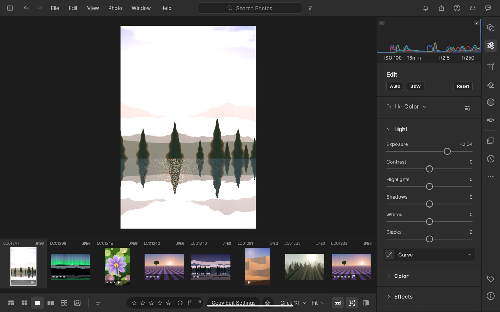
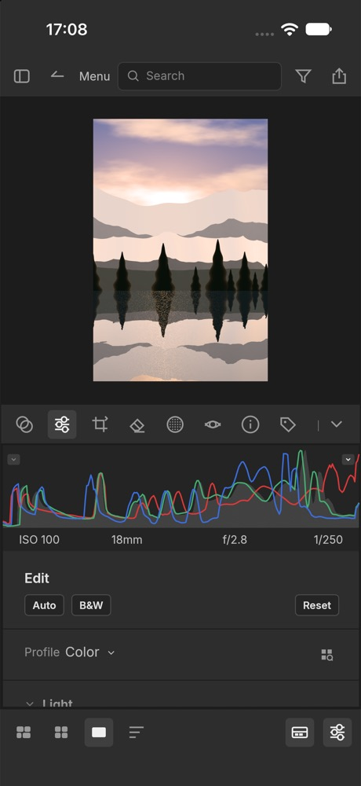
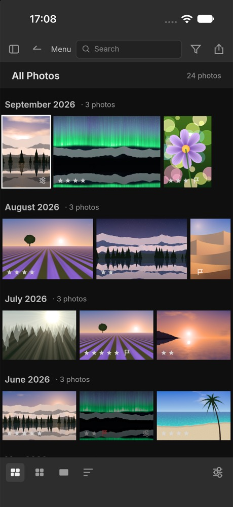
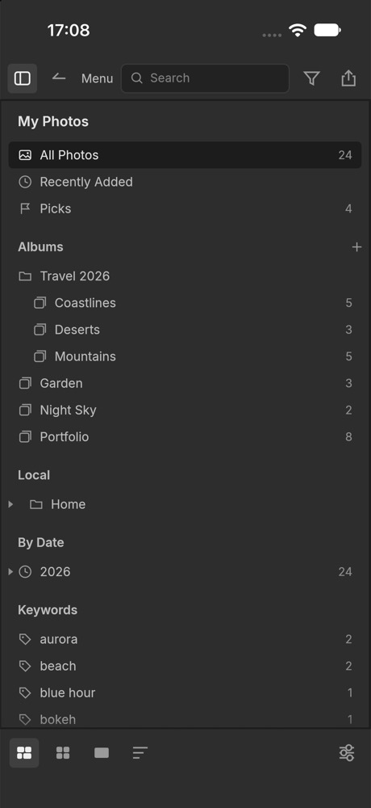
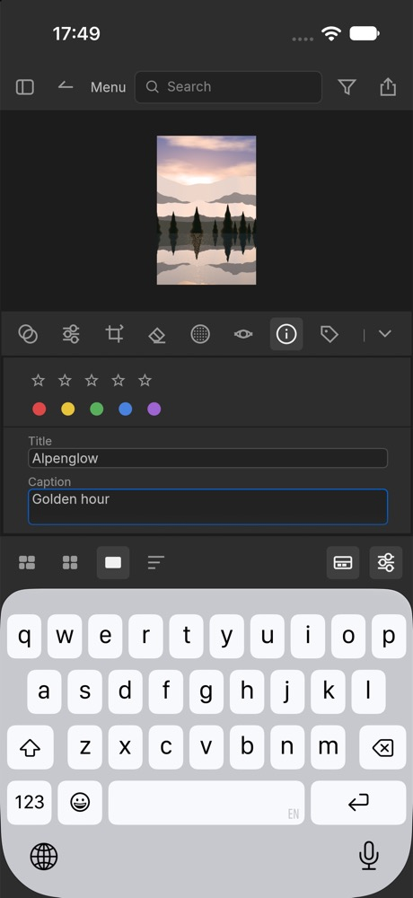
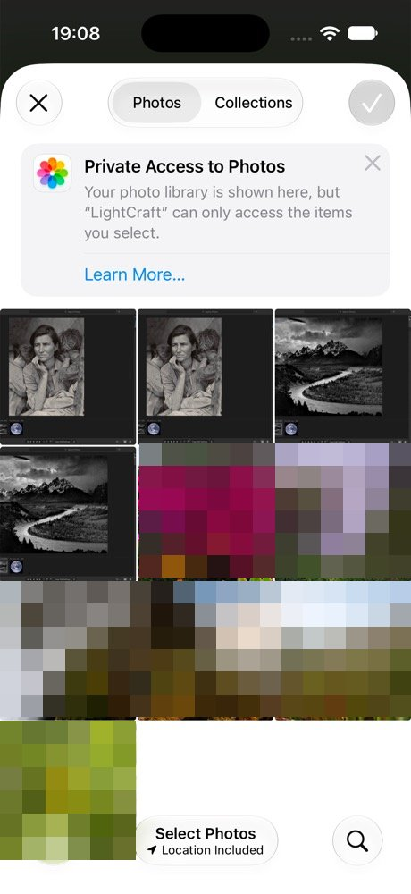
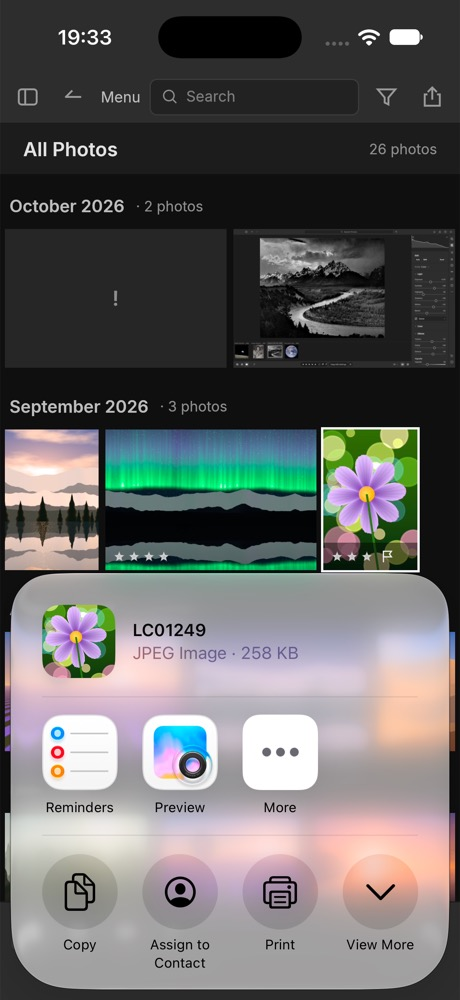
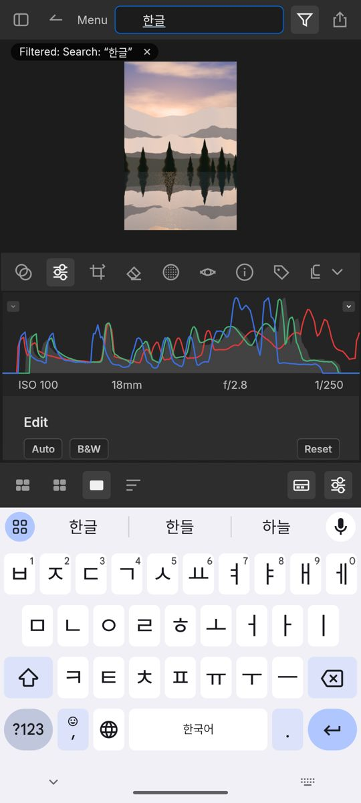

# LightCraft mobile (spike)

The desktop egui UI and engine (with the compact and touch adaptations below) run in a thin
iOS/iPadOS or Android shell. It's a
feasibility spike, not a usable mobile app. The assessment, the effort estimate and the blockers
are in [docs/porting-report.md](docs/porting-report.md).

| iPad (iOS 26.5 Simulator) | iPhone, before the compact layout | Android tablet (API 35 emulator) |
|---|---|---|
|  |  |  |

## Build and run

The rest of the workspace builds this crate empty. It only has code for `target_os = "ios"` and
`"android"`.

```sh
rustup target add aarch64-apple-ios-sim aarch64-linux-android
apps/lightcraft-mobile/scripts/ios-sim.sh            # booted simulator, or pass a device name/UDID
apps/lightcraft-mobile/scripts/ios-device.sh UDID…    # iPhone/iPad: signed, with the icon (see the script for its IOS_* variables)
apps/lightcraft-mobile/scripts/android-apk.sh --run  # builds the APK; --run installs and starts it via adb
```

If `cargo` on `PATH` isn't rustup's, set `CARGO` (for example
`CARGO="rustup run stable cargo"`) so the mobile targets' standard libraries are found.

## What works

- The library opens on disk in the sandbox, seeded with the demo photos. On iOS it's
  `Documents/LightCraft Library`; on Android it's the app's internal data dir. If it can't be
  opened, the desktop's window says why and offers Try Again or Continue Without Saving before
  anything can be edited.
- The UI settings (language, shortcuts, panels …) are kept in `ui.json` next to the models (iOS
  `Library/Application Support/LightCraft`, Android the internal data dir), saved a few seconds
  after a change and at exit (`lightcraft_ui_egui::prefs`).
- The grid, the loupe and every develop control work. A touch drag on a slider renders live.
- GPU compute runs on Metal (iOS). Edits survive a hard kill, because the journal is fsynced
  per command.
- The app icon is the desktop lynx, adapted for each system's mask: an iOS asset catalog with dark
  and tinted versions (compiled by `actool`), and an Android adaptive icon with a themed
  (monochrome) layer. Both are rendered by `packaging/icons.sh`; see `assets/app-icon/README.md`.

## Phone layout

Below 600pt of width or 500pt of height (inside the safe area), `lightcraft-ui-egui` switches to
a compact layout (`crates/ui-egui/src/panels/compact.rs`). It's used on phones in either
orientation, iPad Split View and phone browsers:

- **Top bar:** My Photos, Back, Menu, a search field, Filter and Export.
- **Detail view:** the photo on top, and a bottom sheet with a tool row (Presets, Edit, Crop,
  Remove, Masking, Info …). The sheet shows that panel at full width; Hide puts it away. In
  landscape the sheet is a column at the right of the photo instead. The histogram is lower
  than on the desktop, and the filmstrip is lower in landscape.
- **My Photos:** a full-width drawer (a column at the left in landscape) that closes when you
  pick a source.
- **Grid:** about three thumbnails across the screen's short side, so landscape shows more of
  them, and two rows at least.
- **Filter bar:** its groups wrap onto as many rows as they need.
- **Touch sizes:** on a phone's touch screen buttons, fields, checkboxes and menu items are
  30pt tall (22pt with a mouse). Dialogs span the screen up to 560pt wide and scroll.
- **Before/After Left/Right** stacks the two views when the photo area is taller than wide.
- **Bottom bar:** view modes, Sort, Filmstrip and an Edit toggle.
- **Loupe gestures:** pinch zooms about the fingers, from Fit to 1600%, and pinching back in
  snaps to Fit. Moving both fingers pans. At Fit, a one-finger swipe sideways drags the photo
  along, and letting go past a sixth of the screen shows the next or previous photo. When
  zoomed in, one finger pans as before. A trackpad pinch (or ⌘/Ctrl-scroll) over the loupe
  zooms on the desktop too.
- **Sliders by touch:** a drag that starts sideways adjusts the slider by the distance moved;
  one that starts up or down scrolls the panel, even when it begins on a slider's track. A tap
  doesn't change the value, and double-tap resets. Mouse and trackpad work as on the desktop.
- **Import from the photo library:** File ▸ Import Photos… opens the system picker (PHPicker
  on iOS, Android's photo picker). The chosen photos are copied into `<library>/Picked`, then
  the usual Import review opens. On iOS each photo is fetched as its raw file when it has one,
  as JPEG/PNG/TIFF/WebP when it already is one, and otherwise as JPEG. LightCraft has no HEIC
  decoder yet, so iOS converts HEIC photos (`src/ios_picker.rs`). Android uses a small Java
  subclass of NativeActivity (`android/java/…/LightCraftActivity.java`), compiled by
  `scripts/android-apk.sh` with `javac` and `d8`, because NativeActivity can't receive an
  activity result.
- **Import from a folder:** File ▸ Import from Folder… opens the system's folder picker. On iOS
  that's the Files app's (iCloud Drive, On My iPad, a USB drive or a file server;
  `src/ios_files.rs`), and the import review opens on Copy: a folder outside the app's sandbox
  is readable only while iOS grants access (until the app quits), so the library keeps copies in
  `Originals/`. Android's picker hands over a content URI, not a path, so the Java side copies
  the folder's photos and sidecars (subfolders too) into `<library>/Picked/<folder>`, and the
  review adds them where they are.
- **Copying shows in the activity stack (Android):** while picked photos, files or a folder are
  copied in, a "Copying picked files" row shows how many are done and the file being copied; its
  ✕ stops after that file, and what was copied goes on to the import review. A file whose copy
  fails leaves nothing behind.
- **Other file dialogs:** every command that opens a file shows the system's document picker,
  filtered to the file types it takes: Import Profiles & Presets…, Import Keywords…, Import
  Point Curve Presets…, Auto-Tag from Tracklog…, Locate…, Find Missing Photos…, Import
  Lightroom Catalog…, a face model, an export watermark's graphic. Picked files arrive as
  copies (iOS in `tmp/`, Android in the cache); photos among them move into `<library>/Picked`.
  Commands that save a file (Export Keywords…, Export Presets…, Contact Sheet PDF…) save it in
  the exports folder and open the share sheet with it (Save to Files, AirDrop, Drive …).
  Edit in External Editor offers its edit copy there too, to open in another app.
- **Links and the network:** Help ▸ links, About and the model download pages open in the browser. The Android app asks for the network (`INTERNET`), which face and AI model downloads need.
- **Face recognition and AI Denoise:** as on the desktop (Settings ▸ Faces and ▸ Denoise). Their
  models are kept outside the library, in `Library/Application Support/LightCraft/models` and
  `…/denoise-models` on iOS (not shown in the Files app) and in `<internal data>/models` and
  `…/denoise-models` on Android (`Session::with_models_in`). AI Denoise's Install from file…
  picks the `.onnx` and its `denoise-model.json` together in the document picker.
- **Surviving a reinstall (iOS):** iOS gives a reinstalled or updated app a new container
  path, but the catalog stores absolute paths. When the library opens, the engine relinks
  photos that were inside the library at its old location (such as `Picked/` copies) to the
  same place in the library now. This is general, so it also covers a moved library folder on
  the desktop (`lightcraft_engine::cmd::missing::plan_moved_library`).
- **Memory budget:** set from what the platform allows the process: iOS's jetsam limit
  (`os_proc_available_memory`; the Simulator has none, so half the Mac's RAM), and half the
  RAM on Android. The budget is 40% of that, from 256 MiB to 1 GiB, with 3 decoded previews
  and a 512 MB thumbnail cache. On a memory warning (iOS `didReceiveMemoryWarning`, Android
  `onTrimMemory`, checked every second) the budget drops by a quarter at once, the GPU pool
  is trimmed, free allocator pages go back to the system, and the caches evict on the next
  frame (`src/memory.rs`). Log lines start with `memory:`.
- **Full-resolution cap:** full-resolution work (exports, 1:1) is kept within half of what the
  process may use, at ~60 bytes a pixel. That's about 45 MP on an 8 GB iPhone and 10 MP on the
  2.4 GB emulator. A larger original is decoded and exported at the largest power-of-two
  reduction that fits (½, ¼ …), so decoders reduce while decoding, and the export message
  says "made smaller to fit this device's memory". The engine has this as
  `MediaCache::max_working_pixels`, off by default; `LIGHTCRAFT_MAX_WORKING_MP` tries it on the
  desktop.
- **Tiled full-size exports:** a full-size export over that cap is rendered tile by tile
  instead (`lightcraft_pipeline::tiled`), at its full size. That needs the decoded source and
  the output plus a fixed ~160 MB of tile working memory: ~34 bytes a pixel in all, measured
  on a 60 MP DNG (2.0 GB, against 6.9 GB rendered whole) and a 48 MP JPEG (1.17 GB, against
  3.4 GB). The limit for these (`MediaCache::max_tiled_pixels`, `LIGHTCRAFT_MAX_TILED_MP` on
  the desktop) is about 75 MP on an 8 GB iPhone, and 25 MP on a 4 GB emulator (whose whole
  renders stop at 17 MP). The result matches the whole render within one 8-bit step. The tiles
  render on the GPU when there's room for its extra ~0.75 GB (`max_gpu_tiled_pixels`, about
  57 MP on an 8 GB iPhone), else on the CPU, which is slower: up to 2× a whole render, 6–9× with
  Dehaze, whose wide blur makes the tiles overlap a lot (on the GPU 2–4×). A GPU whose buffers
  can't hold a whole export (Android's 128–256 MB limits) renders it in tiles too, instead of on
  the CPU. Edits that read the whole photo (spot
  removal, Refine Edges, Auto Mask brushes, subject/background masks) still export smaller.
- **Export and share:** exports go to a folder next to the library (`Documents/LightCraft
  Exports` on iOS, so they show in the Files app; the app's private files on Android). When an
  export from the Export dialog finishes, the share sheet opens with the files: AirDrop, Save
  to Photos, Messages and other apps. On iOS that's UIActivityViewController
  (`src/ios_share.rs`, anchored as a popover on iPad). On Android it's an `ACTION_SEND` chooser
  over `content://` URIs from a small read-only `FilesProvider` (androidx's FileProvider
  without androidx). `ui-egui` gained two optional host services for this, `export_dir` and
  `share`.
- **Hardware keyboard (iPad):** shortcuts work from a Magic Keyboard or any Bluetooth keyboard,
  with ⌘ as the command key (menus show ⌘), plus arrows, Escape and the single-key shortcuts.
  winit 0.30's iOS view only receives typed text, so while no text field has focus a hidden view
  of the shell (`src/ios_keys.rs`) is the first responder and turns `UIPress` key codes into egui
  key events (`lightcraft_ui_egui::hid`). In a text field another hidden view takes the keyboard:
  it receives typed text (with the system's dead keys) and turns ⌘ / ⌃ combinations, arrows,
  Escape and Tab into key events, so ⌘A, ⌘C, ⌘X, ⌘V, ⇧-arrows and ⌘Z work there too. Copying and
  pasting go through the system pasteboard.
- **Apple Pencil:** pressure sizes the mask brush (a light touch paints a quarter of the brush
  size), a double tap swaps the brush between Add and Erase (when the system's double-tap setting
  is "switch to eraser" or "previous tool"), and a Pencil hovering above the screen (or a trackpad
  pointer) moves the pointer, so the brush outline and hover highlights show before touching
  (`src/ios_pencil.rs`; winit 0.30 reports neither).
- **iPad trackpad and mouse:** a two-finger click or right click opens the context menu, two-finger
  scrolls and wheels scroll, and a trackpad pinch zooms the loupe (`src/ios_pencil.rs`: winit
  0.30 reports every click as a touch). `ios/Info.plist` sets
  `UIApplicationSupportsIndirectInputEvents`, without which iPadOS turns trackpad clicks into
  finger touches with no button. A mouse's right button on Android still acts as a tap: Android
  hands input to winit directly, which drops the button.
- **Touch and pencil:** the canvas tools grab at the point a finger or pencil went down, handles
  reach at least 22 pt, a lifted finger still "clicks" menu items, and new linear / radial
  gradients are drawn by dragging on the photo.
- **What the desktop does with hover, modifiers, drags and keys** has a touch way in:
  - **Selecting several photos:** Select in the bottom bar (or Edit ▸ Select Several, or
    "Select Several" in a photo's long-press menu): taps add photos to the selection and take
    them out, as ⌘-click does, with a tick on each; Done ends it.
  - **Double taps** do what double clicks do (open a photo, reset a slider, delete a curve
    point, reset a colour wheel, rename a mask or version …): two taps on the same control
    within half a second, wherever on it they land.
  - **Controls shown on hover** are always there on a touch screen: a section's on/off eye, a
    mask's eye, face boxes' handles, × and "Add name", Survey's ×, a person's "More" tiles, the
    Profile Browser's stars, the Keyword List's arrow.
  - **Drag and drop:** a finger's drag scrolls, so albums and folders get Move Up / Move Down in
    their long-press menu, and keywords get Move to ▸ (Top Level or inside another keyword).
    Photos go into albums with Add to Album. A trackpad or mouse on an iPad still drags.
  - **Full screen and slideshows** show Exit and Pause / Play (Esc, F and Space on a keyboard).
  - **Compare:** View ▸ Previous / Next Candidate (← / →).
  - **Masks:** Color Range's Add makes taps add samples (⇧-click); the Object tool's Include /
    Leave Out (⌥-click).
  - **Phone grid:** pinch to show more or fewer photos across (the desktop's size slider), and
    Info, Keywords, Versions and History open in the bottom sheet over the grid.
- **Testing:** the desktop's control channel (`docs/control-protocol.md`) can be turned on: set
  `LIGHTCRAFT_CONTROL_PORT` on iOS (`SIMCTL_CHILD_LIGHTCRAFT_CONTROL_PORT=18310 xcrun simctl
  launch …`; the Simulator shares the Mac's loopback), or write the port to
  `/data/local/tmp/lc_control` on Android and `adb forward tcp:PORT tcp:PORT`. Then
  `lightcraft-cli run --connect 127.0.0.1:PORT …` drives the app. Nothing a user launches
  turns it on.
- **Soft keyboard:** the layout moves up above the keyboard (bottom bar, sheet, dialogs), and a
  focused text field it would cover is scrolled into view. On iOS the shell's scene delegate
  reads the keyboard frame from UIKit. On Android the shell compares the decor view's
  `getWindowVisibleDisplayFrame` with the window's bounds over JNI
  (`src/android_jni.rs`), which also keeps the UI clear of the navigation bar. Either way
  the result becomes egui's safe-area insets.
- **Typing on Android (IME):** NativeActivity's view has no input connection, so keyboards fall
  back to key events: no composing. While an egui text field has focus, the keyboard types
  into an invisible editor view instead (`android/java/…/TextInput.java`). Its input connection
  keeps a copy of what was typed, which the keyboard reads for suggestions, and reports the
  cursor to the keyboard after every edit. Composing text, commits, deletions and re-opened
  words are queued, wake the app over a JNI-registered native method, and become egui IME
  events (`Preedit`, `Commit`, `DeleteSurrounding`). Keys the keyboard sends (Delete with
  nothing to delete, Enter) still arrive as key events. The keyboard's copy starts as the
  field's text and cursor, and follows changes made outside the keyboard: a tap or an arrow key
  moving the cursor (ending a composition there, without duplicating it), Delete keys,
  hardware keys. egui reports the text in its output events and keeps the cursor in the field's
  state; a sync waits until egui has applied every edit the keyboard queued. Each field's IME
  purpose sets the editor's input type: a password field (`TextEdit::password`) gets Android's
  password type, so the keyboard shows no suggestions, learns nothing and switches to a Latin
  layout, and its copy only ever holds egui's masked text; a terminal-style field gets no
  suggestions. (LightCraft has no password fields today; this was checked with the search field
  made one in a local build.) Numbers typed into egui drag values (capture-time shift and time
  zone, rename "Start at", the smart-collection rules) get the number pad with a minus sign and a
  decimal point: a drag value reports itself when clicked, which focuses the text field it turns
  into, so the shell remembers which focus came with it, and its value. The field reports no
  text as it starts, and egui keeps it private, but it starts all selected: the keyboard's copy
  is the value in egui's number format with the count of decimals that gives the selection's
  length ("0.00", "-5.50", "0" for "0 h"). A custom formatter that matches no such count leaves
  the copy empty until the first edit. Korean (Gboard 2-set) composes
  syllable by syllable, and backspace decomposes them. Text in scripts the bundled fonts lack
  shows in the system's Noto Sans CJK, memory-mapped and picked for the device's locale.
- **Dialogs:** Export, Import, Settings, Merge and the rest span the screen width and scroll
  when they're taller than it. Labels sit above their controls, and button rows wrap. The Merge
  preview stacks above its options, and the Shortcuts table scrolls sideways.

The whole UI stays inside the iOS safe area (status bar, Dynamic Island, home indicator).

| | Edit sheet | Grid | My Photos | Export dialog | Typing a caption |
|---|---|---|---|---|---|
| iPhone 17 (iOS 27) |  |  |  |  |  |

| Photo picker (iOS) | Import review (iOS) | Import review (Android) | Share sheet (iOS) | Share sheet (Android) |
|---|---|---|---|---|
|  |  |  |  |  |

| Composing Korean (Android) |
|---|
|  |

## Known problems

- **iOS scene lifecycle is adopted by the shell, not winit.** winit 0.30 has no UIScene support,
  and iOS 27 kills apps without it. `src/ios_scene.rs` and the scene manifest in `ios/Info.plist`
  attach winit's window to the scene, which works on iOS 26.5 and 27.0. There's one scene only
  (no multiwindow), and this goes away when eframe moves to winit 0.31.
- **Phone layout is a first pass.** Narrow and short windows get a compact layout and
  phone-sized dialogs (see above). Survey on a phone shows every photo at once, so with many
  selected the thumbnails get small.
- **Soft keyboard.** On iOS, tapping the photo to dismiss the keyboard also toggles its zoom.
  On Android the insets are polled (about 10 times a second while typing and for a second
  after, twice a second otherwise), so the layout follows the keyboard a moment late. Composing was
  verified with Korean on Gboard. English on the emulator's Gboard commits letter by letter (as it
  does in a stock `EditText` there), so English autocorrect and swipe typing are still
  unverified, and Japanese/Chinese keyboards weren't tried.
- **Touch.** The desktop layout's hit targets are small (an iPad's), and hover previews of
  presets and profiles have no touch equivalent (their thumbnails show the look). Without a
  hardware keyboard, a few things stay out of reach: the smart-album rule editor's ⌥-click
  (insert a group after a rule), a radial mask's ⌥ (resize evenly), and the click-zoom ratio
  (pinch zooms instead). Open Library…, Browse Folder… and Move Folder To… need a folder the
  app may keep, which the mobile sandboxes don't offer. There's no inertia when panning a zoomed photo, and no double-tap-to-zoom gesture
  beyond the existing tap toggle. The tone curve and color wheels still take every drag that
  starts on them, since they're two-dimensional controls.
- **Some full-size exports still come out smaller on phones.** A whole-image render peaks near
  60 bytes a pixel, so full-resolution work is capped, and full-size exports over the cap are
  tiled (see above). Exports with edits that can't be tiled, originals too big even for tiles,
  and resized exports that downscale by more than 1.25× still come out smaller. GPU tiling is
  measured on Apple silicon only (Android's GPU compute is untested), and the 1:1 view is still
  capped. A phone portrait (EXIF-rotated) briefly
  holds two copies of the decoded original while it's rotated.
- **Import caveats.** Picked photos are copied into `<library>/Picked`, so they take up space
  twice. On Android the picker hides original file names, so photos arrive named after their
  media IDs, and HEIC/HEIF is converted to JPEG on the Java side (losing EXIF). Raw files from
  the photo library haven't been tried on either platform, because there was no raw sample to
  add to the simulators.
- **Android.** The window uses GL, because the emulator's Vulkan surface fails to configure;
  `adb shell touch /data/local/tmp/lc_vulkan` tries Vulkan. Logs go to logcat, tag
  `LightCraft` (`adb logcat -s 'LightCraft:*'`).
